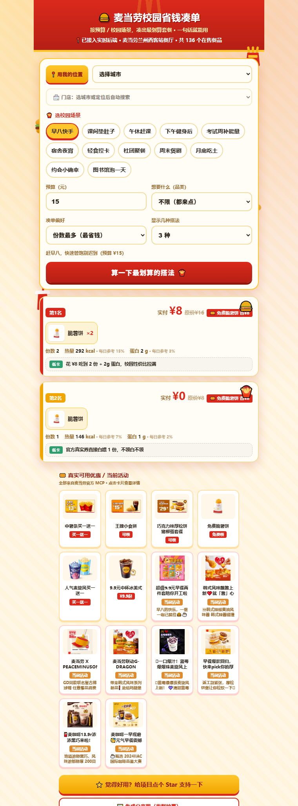
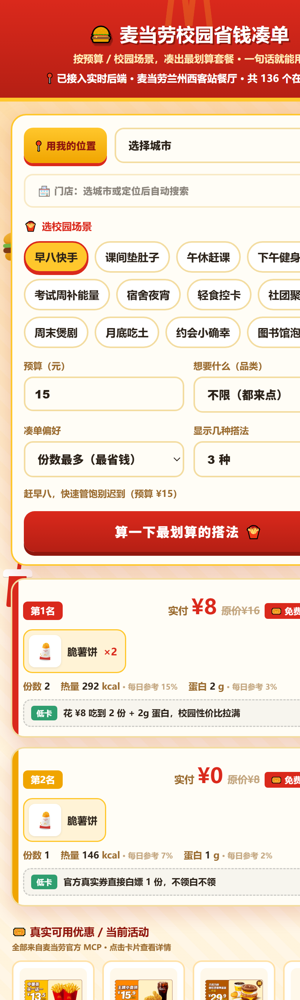

<div align="center">


<br>

[](https://open.mcd.cn/mcp)
[](#数据都从哪来)
[](#项目介绍)
[](#数据都从哪来)
[](#在线体验)

晚上 11 点，宿舍楼下，兜里预算 20 块，想吃饱、不想全是炸的、还得赶在门禁前吃完——
这种决定，不该靠饿着肚子纠结三分钟。

**麦麦校园搭子把「校园时刻」当作第一位输入**：你处在一天中的哪个节点（早八、课间、考试周、夜宵……共 12 种），决定了你该吃什么；然后它用麦当劳官方 MCP 的实时菜单、优惠券和营养数据，在预算内替你算出怎么点——并告诉你「为什么是这份」。

[🌍 在线体验（国内直连）](https://cloud1-d3g3n612g3037e59b-1398369080.tcloudbaseapp.com/index.html) · [⚡ GitHub Pages](https://penk-git.github.io/mcd-campus-combo/) · [真实例子](#使用示例)

</div>

---

## 校园党的一天

同一个预算，不同时刻，它给出的答案完全不同：

| 时刻 | 场景 | 它替你考虑的 |
|:---:|---|---|
| 7:50 | 早八快手 | 单手能拿、两口能吃、不迟到——份数优先，热量管够不管多 |
| 10:20 | 课间垫肚子 | 小食组合，垫一下就行，不占午饭的胃 |
| 12:00 | 午休正经吃饭 | 券自动匹配：用了哪张、省了几块，实付清清楚楚 |
| 16:30 | 运动完加餐 | 按蛋白密度挑——花同样的钱，补更多蛋白质 |
| 21:00 | 考试周续命 | 每元蛋白质优先，附「约等于几个鸡蛋」的每日参考占比 |
| 23:30 | 宿舍夜宵 | 每元热量优先，甜品降权——要的是顶饱一整晚 |

## 它是怎么算的

三步，全程不猜价格：

1. **你说人话** —— 「考试周，预算 25，想吃高蛋白的」，不用学任何指令格式
2. **它拉真实数据** —— 按你的定位找到门店，从麦当劳 MCP 取当前在售餐品、营养、券和活动；实时拉不到就用本地全量快照顶上（页面会如实标注）
3. **它算并解释** —— 预算内枚举组合，按当前场景的目标排序（份数 / 每元热量 / 每元蛋白），每个方案附营养解读：每日参考占比多少、蛋白密度多少、为什么适合此刻的你

## 在线体验（无需安装，10 秒试玩）

打开 👉 **https://penk-git.github.io/mcd-campus-combo/** 即可在浏览器里选场景、调预算，实时看到 Top3 凑单方案。
（手机也能开，适合发到社团群让同学一起凑。菜单与营养数据来自麦当劳中国官方 MCP 实时快照 `real_menu.json`，优惠券/活动来自官方 MCP 真实接口，以官方实时为准。）

## 界面实拍

| 桌面端（含真实优惠面板） | 移动端（自适应布局） |
| :---: | :---: |
|  |  |

> 启用方法：本仓库已含 `index.html`（单页 demo）。在仓库 **Settings → Pages → Source 选 `main` / `root`** 即可上线上面的地址。

## 项目介绍
一个面向**学生党**的麦当劳凑单助手：按你的**预算**和**校园场景**，调用麦当劳中国 MCP 拉取实时菜单与优惠，在预算内算出**性价比最高的凑单方案**，并给出**场景化营养叙事**（每日参考占比、蛋白密度 g/kcal、一句话解读「为什么这份适合你」）。

不靠拍脑袋编价格——餐品、营养、优惠券全部来自麦当劳 MCP 真实接口（available-coupons / query-store-coupons / campaign-calendar），以官方实时返回为准。

## 目标用户
- 学生党（早八、课间、考试周、夜宵、社团拼单）
- 想用最少预算在麦当劳吃值的任何人

## 安装方法
### A. 在 WorkBuddy 里用（推荐，参与官方联动奖励）
1. 申请麦当劳 MCP Token：https://open.mcd.cn/mcp （手机号登录 → 控制台 → 激活）
2. 左侧【专家·技能·连接器】→【连接器】→【自定义连接器】→【配置 MCP】，粘贴 `mcp-config.example.json`（把 `${MCD_MCP_TOKEN}` 换成你的 Token）并启用 `mcd-mcp`
3. 把本仓库作为 Skill 导入 WorkBuddy，直接对话：「预算 20 怎么点麦当劳最划算」

### B. 命令行独立运行（参考实现）
```bash
export MCD_MCP_TOKEN=你的Token        # 在线模式需要
python campus_combo_finder.py --mock --profile 早八快手   # 离线演示（无需 Token）
python campus_combo_finder.py --profile 考试周补能量      # 在线：实时拉菜单+优惠
```
依赖：仅 Python 3.8+ 标准库（urllib / json / itertools），无需 pip 安装。

## 使用示例
> 用户：考试周想吃点高蛋白的，预算 25
> 助手：（调用 query-meals + list-nutrition-foods + calculate-price，以下为真实数据示例）
```
第1名  实付 ¥23（原价 ¥28）
  组合：那么大鸡排（椒盐风味）×2
  份数 2 ｜ 热量 770kcal ｜ 蛋白 48g
```

> 用户：社团聚餐拼单，60 块怎么点份数最多
> 助手：（调用 query-meals + query-store-coupons + calculate-price，以下为真实数据示例）
```
第1名  实付 ¥22（原价 ¥30 【满30减8】）
  组合：苹果片×2 + 脆薯饼×2
  份数 4
```

## 目录结构
```
CONTEST_DECLARATION.md   # 参赛声明（内容不可改）
README.md                # 本文件
index.html               # 单页在线 demo（GitHub Pages，10 秒试玩）
combo.js                 # demo 用的纯 JS 凑单算法（与 Python 版等价，可 Node 校验）
SKILL.md                 # WorkBuddy Skill 定义（联动奖励载体）
MCP_INTEGRATION.md       # MCP 调用说明（用了哪些 Tool、怎么调）
mcp-config.example.json  # 脱敏配置示例（仅环境变量占位符）
workbuddy.md             # WorkBuddy 开发上下文（参与专项奖时必交）
campus_combo_finder.py   # 凑单核心算法（含离线 mock 自测 + 在线 MCP 接入）
mcd_mcp_client.py        # 麦当劳 MCP Streamable HTTP 客户端（标准库实现）
build_real_menu.py       # 用官方 MCP 拉取真实菜单/营养/券，导出 real_menu.json + real_menu.js 快照
real_menu.json           # 真实菜单快照（来自官方 MCP，含来源/门店/餐品/营养）
real_menu.js             # real_menu.json 的 JS 版（供 index.html 直接加载，免 fetch/CORS）
```

## 数据都从哪来
```
官方 MCP（mcp.mcd.cn）
 ├─ query-meals            → 当前门店在售餐品（名称/价格/分类/标签）
 ├─ list-nutrition-foods   → 能量/蛋白质等营养数据
 ├─ available-coupons      → 全国通用券（免费领/买一送一/固定价）
 ├─ query-store-coupons    → 所选门店专属券（随门店变化）
 ├─ campaign-calendar      → 当前营销活动
 ├─ query-nearby-stores    → 周边门店（名称/地址/距离）
 └─ calculate-price        → 真实计价（含券）
        │
        ▼
real_menu.json（本地全量快照：136 餐品 + 6 券 + 26 活动）
        │  实时拉取失败时自动回退，页面照常演示
        ▼
index.html（网页 demo） / campus_combo_finder.py（CLI）
```

> ⚠️ 本作品为参赛者独立开发，非麦当劳官方产品。餐品信息、价格及供应状态以麦当劳官方渠道实时结果为准。
